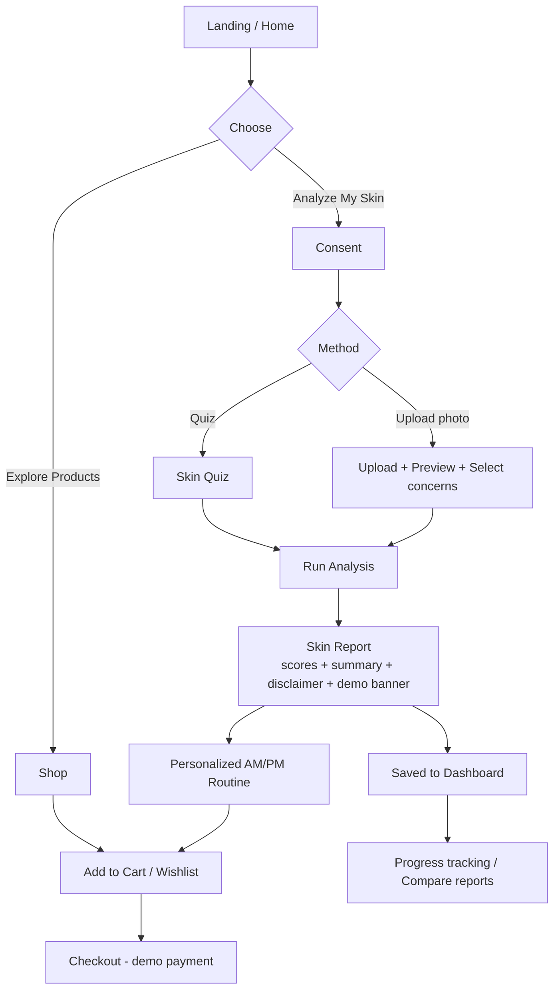
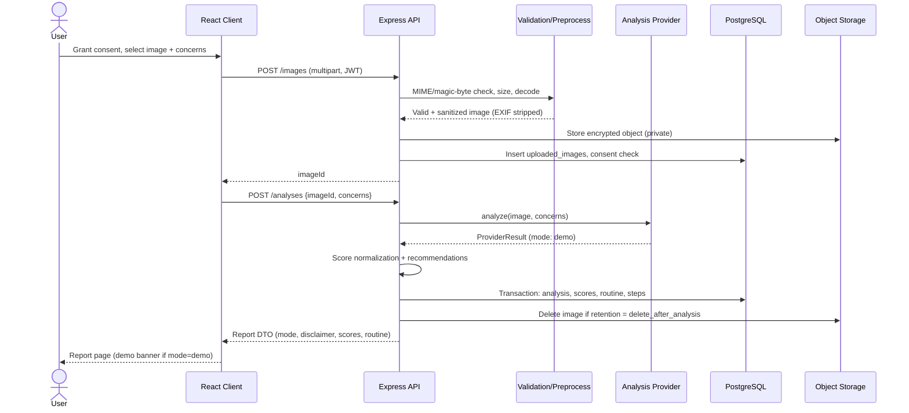
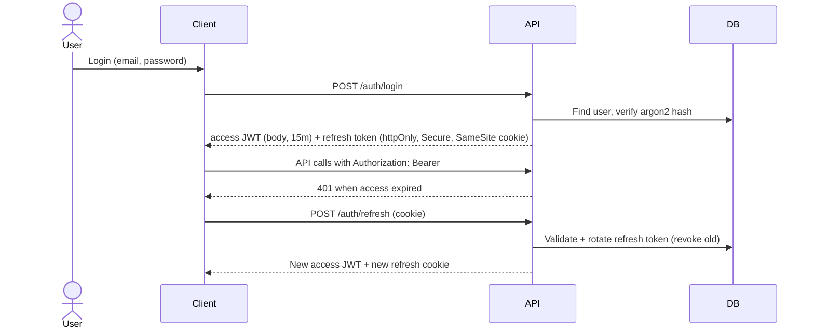

> **GlowNest – AI-Powered Skincare & Beauty Platform** | PERN Stack (PostgreSQL, Express.js, React.js, Node.js, all TypeScript) | AI: Demo Mode (Phase 1)

# 3. System Workflow

## 3.1 User Journey Overview

## 3.2 Skin Analysis Sequence

## 3.3 Authentication Workflow

Reuse of a revoked refresh token revokes the whole token family (theft detection).

## 3.4 Purchase Workflow
1. Browse/search/filter → product detail → **Add to cart** (guest cart in localStorage).
2. Login/register → `POST /cart/merge` merges guest cart.
3. Cart review → quantity update/remove → **Checkout**.
4. Enter shipping address → choose shipping → review summary.
5. **Demo payment step** (labeled "No real payment is taken") → `POST /orders` with idempotency key.
6. Server re-prices from DB (never trusts client prices), decrements stock in a transaction, creates order.
7. Confirmation page + order history entry.

## 3.5 Reminder Workflow
User creates reminder (AM/PM, time, timezone, channel) → stored → scheduler runs every minute, finds due reminders by timezone → sends email / creates in-app notification → logs delivery.

## 3.6 Data Lifecycle & Privacy Workflow
| Event | Action |
|---|---|
| Consent withdrawn | Block further image analyses; offer deletion of stored images |
| Analysis with default retention | Raw image deleted right after analysis; only scores/report stored |
| "Keep for progress" selected | Image stored, auto-expires per retention policy (default 12 months) |
| User deletes report/image | Hard delete from DB and object storage |
| Account deletion | Cascade delete user data; anonymize orders as required by law; purge within 30 days incl. backups rotation |

## 3.7 Error & Empty State Handling
- Validation failure → inline field errors with clear fix guidance.
- Image rejected → specific reason (too dark/blurry/small/unsupported).
- Network/API error → error card with **Retry**.
- No data → friendly empty states with a next action (e.g., "No reports yet → Analyze My Skin").
